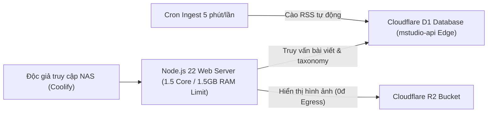

# Hướng Dẫn Triển Khai MStudio Trên Máy Chủ NAS (Coolify + Cloudflare D1 Backend)

> **Mô hình Hybrid Tối Ưu:** Web Portal chạy trên máy chủ NAS cá nhân (Coolify) — Cơ sở dữ liệu và Ingest tiếp tục chạy trên **Cloudflare D1 Edge** để đạt tốc độ truy xuất nhanh nhất, tự động đồng bộ thời gian thực 24/7 mà không cần nạp/sao lưu thủ công.

---

## 1. Ưu Điểm Tuyệt Đối Của Mô Hình "NAS Web + Cloudflare D1"

1. **Không cần chép hay import database thủ công:** Toàn bộ 530+ bài viết, nguồn tin RSS quốc tế và các bài cập nhật mỗi 5 phút đều nằm trực tiếp trên Cloudflare D1. Web trên NAS chỉ cần gọi API Edge (`https://mstudio-api.vn002187444.workers.dev`).
2. **NAS chạy siêu nhẹ:** Web Server chỉ tiêu thụ dưới **0.2 core CPU** và **200MB RAM**, hoàn toàn không tiêu tốn I/O ổ đĩa SSD của NAS.
3. **Độc lập 100% khỏi GitHub Actions:** Quá trình build và deploy diễn ra cục bộ trên Docker của NAS thông qua Coolify.

---

## 2. Quy Trình 2 Bước 1-Click Triển Khai Trên Coolify (Chỉ 2 Phút)

### Bước 1: Tạo Resource trong Coolify Dashboard

1. Mở giao diện Coolify: `http://<IP_NAS>:8000`.
2. Vào mục **Projects** $\rightarrow$ chọn **+ New Project** $\rightarrow$ đặt tên `MStudio`.
3. Chọn **+ New Resource** $\rightarrow$ Chọn **Docker Compose**.
4. Dán toàn bộ nội dung từ file [`docker-compose.coolify.yml`](file:///d:/MStudio/docker-compose.coolify.yml) (hoặc liên kết Git repo `https://github.com/vn002187444/MStudio.git`).
5. Cấu hình biến môi trường sẵn có:
   - `MSTUDIO_API_URL=https://mstudio-api.vn002187444.workers.dev`
   - `PORT=3000`
   - `CLOUDFLARE_TUNNEL_TOKEN=<Token_của_bạn>` (nếu muốn dùng Cloudflare Tunnel để giấu IP thật của NAS).

---

### Bước 2: Bấm "Deploy"

- Coolify sẽ tự động tải các dependencies, build giao diện SSR và khởi chạy tại cổng `3000`.
- Truy cập ngay: `http://<IP_NAS>:3000` để trải nghiệm giao diện tin tức MStudio Channel thế hệ mới!

---

## 3. Kiến Trúc Hoạt Động (Data Flow)

